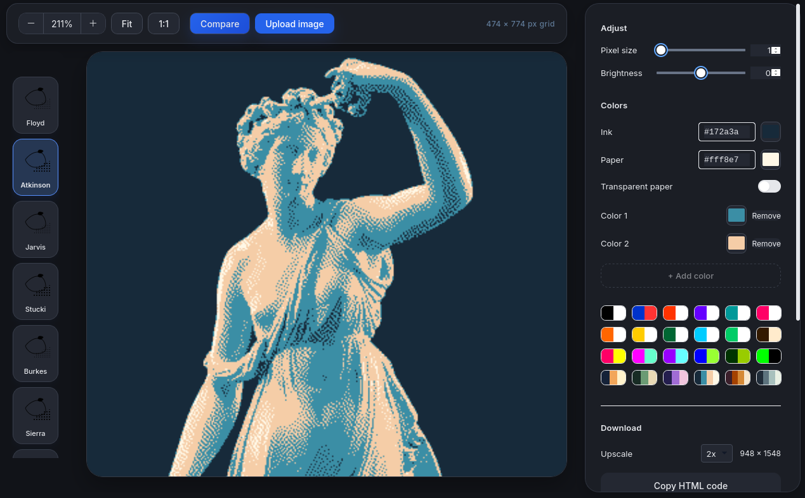

A lightweight, browser-based dithering and bitmap processing tool.

The tool runs in a web browser or as a desktop app built with [Tauri](https://v2.tauri.app/). Media processing happens locally using your browser's Canvas API. Video formats depend on browser support.

The interface uses HTML, JavaScript, [Tailwind CSS](https://tailwindcss.com/), [Phosphor Icons](https://phosphoricons.com/), and the Inter font. The desktop wrapper uses Tauri and Rust.



## Use it in your browser

No installation or build step is needed for the browser version. Styles, fonts, icons, and media-processing libraries load from the bundled `public/assets` files, so the editor works offline; optional Lospec palette loading requires a network connection.

1. Download the repository, or clone it:

   ```bash
   git clone https://github.com/cybergatovgm/DitherTool/.git
   cd DitherTool
   ```

2. Open [public/Bitmaptool.html](public/Bitmaptool.html) in a modern browser, such as Chrome, Firefox, Safari, or Edge.

Keep the `public` folder's files together if you do move the files to another location. The tool loads [example_image.jpg](public/example_image.jpg) when it opens. If the image is missing, the canvas stays blank until you upload one!

## Make your first image

1. Click **Upload image or video** to choose an image, animated GIF, or browser-supported video, or try the built-in example.
2. Choose a dithering algorithm below the preview. Start with **Floyd** for a balanced result or **Bayer** for a regular pattern.
3. Adjust **Pixel size** and **Brightness**. A larger pixel size gives a chunkier look.
   When a video or animated GIF is loaded, use the timeline below the preview to scrub through it. Select the diamond beside **Pixel size**, **Brightness**, **Contrast**, or **Midpoint** to add or update a keyframe at the current time; values interpolate between keyframes and are included in GIF exports.
   Scrubbing, recording a keyframe, or editing an animated setting pauses playback so edits stay at the displayed time. Clicking a keyframe marker seeks to its exact position. Scrubbing to the end holds the last frame; **Play preview** resumes looping playback. Changing the extended pixel-size limit does not overwrite existing keyframes.
4. Pick a palette or set the **Ink** and **Paper** colors. Use the **Maximum palette size** slider at the bottom of the sidebar to allow up to 8, 16, or 32 colors, then add colors or enable **Transparent paper**.
   To load a palette from Lospec, paste its palette-list URL or slug into the Lospec field and choose **Load from Lospec**. Loaded palettes are added to the palette swatches for reuse.
5. Use **Compare** and drag the divider to compare the original with the result. Use the zoom controls or **Fit** to adjust the view.
6. In **Download**, choose an **Upscale** value and save a **PNG** or **SVG**. Set **GIF duration (seconds)** from 0.1 to 15 in 0.1-second increments, then choose **Download GIF**. Animated GIFs and videos are trimmed from the start without changing playback speed; shorter sources are not extended. Still images use a single frame with the selected duration. The default is 15 seconds, and **Reset to defaults** restores it. GIF exports are limited to 10 frames per second and 480 pixels wide. You can also copy the image or its HTML code.

For more control, adjust **Contrast** and **Midpoint** in the **Adjust** section. Clipboard features may depend on browser permissions.

Use **Reset to defaults** at the bottom of the sidebar to restore the default editor settings, theme, and language without removing the current image.
On phones, swipe the top toolbar to reach its buttons, browse algorithms horizontally, and scroll the settings panel independently of the preview.

## Choosing a dithering algorithm

Dithering uses small patterns of pixels to suggest shades with a limited set of colors.

| Type | Available methods | What to expect |
| --- | --- | --- |
| Threshold | Threshold | A simple cutoff between colors, with no added pattern. |
| Ordered | Bayer 2×2, 4×4, 8×8, and 16×16; Blue noise; Halftone | Repeatable textures, from regular grids to clustered dots. |
| Error diffusion | Floyd, Atkinson, Jarvis, Stucki, Burkes, Sierra, Sierra 2-row, and Sierra lite | Patterns that spread color differences to nearby pixels to preserve shading. |

Try several methods with the same image: the best choice depends on the detail and texture you want.

## Languages and themes

Use the **Language** selector at the bottom of the sidebar to choose English, Brazilian Portuguese, or Spanish. Your choice is saved between sessions.

The **Theme** selector changes the interface appearance, not your image's color palette.

## Run the desktop app from source

The requirements below are only for desktop development. You do not need them to use the browser version.

### Requirements

- Node.js 18 or newer and npm 9 or newer.
- Rust 1.90 or newer, with `cargo` and `rustup`. The minimum Rust version is defined in [src-tauri/Cargo.toml](src-tauri/Cargo.toml).
- The platform dependencies listed in the [Tauri prerequisites guide](https://v2.tauri.app/start/prerequisites/).

On Linux, install the system libraries before running the app.

**Fedora:**

```bash
sudo dnf install -y \
  gcc gcc-c++ make \
  gtk3-devel webkit2gtk4.1-devel openssl-devel \
  librsvg2-devel patchelf libayatana-appindicator-devel
```

**Debian / Ubuntu:**

```bash
sudo apt install \
  build-essential libgtk-3-dev libwebkit2gtk-4.1-dev \
  libssl-dev librsvg2-dev patchelf libayatana-appindicator3-dev
```

### Start the app

From the repository root:

```bash
npm install
npx tauri dev
```

Installing dependencies may require an internet connection. After installation, the app can run and regenerate its interface assets offline.

### Update interface assets

Tailwind styles, Inter fonts, Phosphor icons, and the locally bundled GIF decoder and encoder are in `public/assets`. These generated files are included in the repository so browser users do not need Node.js or npm.

After changing Tailwind classes in [public/Bitmaptool.html](public/Bitmaptool.html), regenerate the assets:

```bash
npm run build:assets
```

Include updated assets with your changes. Tauri runs this command automatically before development and production builds. Keep the entire `public` folder together when distributing the browser version, including its `assets` folder. Third-party license notices are included in `public/assets/licenses`.
Run `npm test` to check animated GIF processing and the bundled offline media assets.

Run `npm run test:assets` to check that local resource files and the required styles, icons, and fonts are present.

## Build an Android APK

Install Rust, Android Studio or the Android SDK command-line tools, Android platform/build tools, and Android NDK. Use a JDK 17 or newer and install the Rust Android target for the device ABI (for example, `aarch64-linux-android` for most modern Android phones).

Set `ANDROID_HOME` and `ANDROID_SDK_ROOT` to your SDK directory, then initialize the Android project once:

```bash
npx tauri android init
```

Build a release APK for 64-bit ARM devices:

```bash
npx tauri android build --apk --target aarch64 --ci
```

The APK is written under `src-tauri/gen/android/app/build/outputs/apk/`. Build other supported device ABIs with `--target armv7`, `--target i686`, or `--target x86_64`.

## Build desktop installers

Install the desktop requirements and npm dependencies first. Run all build commands from the repository root.

### Download v0.2.0

Desktop releases are available on [Codeberg](https://codeberg.org/cybergato/Dither.tool/releases/tag/v0.2.0) and [GitHub](https://github.com/cybergatovgm/Dither.tool/releases/tag/v0.2.0):

- Windows x64: NSIS `.exe` installer (unsigned).
- Fedora x86_64: `.rpm` package.
- Debian 12 or newer amd64: `.deb` package.
- Linux x86_64: `.AppImage` (Debian 12 / glibc 2.36 baseline).

Linux packages require GTK 3 and WebKitGTK 4.1. AppImage users may also need their distribution's FUSE 2 package, or can launch with `--appimage-extract-and-run`.
The releases include SHA-256 checksums for the installers.

### Build Linux releases with the Debian 12 baseline

Use Podman to avoid linking release binaries against newer host libraries:

```bash
podman build -t dither-release-linux -f scripts/release-linux.Containerfile scripts
podman run --rm --userns=keep-id \
  -e CARGO_HOME=/app/src-tauri/target/container-cargo \
  -e CARGO_TARGET_DIR=/app/src-tauri/target/debian12 \
  -v "$PWD:/app:Z" \
  -v dither-release-node-modules:/app/node_modules:U dither-release-linux
```

Release packages are written to `src-tauri/target/debian12/release/bundle/`.
The container uses x86_64 Node.js and is intended for an x86_64 build host.

### Build for your current platform

```bash
npx tauri build
```

On Linux, packages are written to:

- `src-tauri/target/release/bundle/appimage/` — AppImage.
- `src-tauri/target/release/bundle/rpm/` — RPM.
- `src-tauri/target/release/bundle/deb/` — Debian package.

### Build a Windows installer from Linux

Cross-compiling requires additional tools. On Fedora:

```bash
sudo dnf install -y mingw32-nsis lld llvm clang
```

With Rust and `rustup` already installed, add the Windows target and build runner:

```bash
rustup target add x86_64-pc-windows-msvc
cargo install --locked cargo-xwin
```

If your shell cannot find Cargo commands, add them to its path:

```bash
export PATH="$HOME/.cargo/bin:$PATH"
```

Then build:

```bash
npx tauri build --runner cargo-xwin --target x86_64-pc-windows-msvc
```

The Windows `.exe` installer is written to `src-tauri/target/x86_64-pc-windows-msvc/release/bundle/nsis/`.

### Translations

In [public/Bitmaptool.html](public/Bitmaptool.html), add a language entry to `I18N` and its display name to `LANGUAGE_NAMES`.

## Contributing

Please don't use AI to contribute or make commits, don't waste my time.

Other than that Contributions are more than welcome!

## License

This project is available under the GNU AGPLv3 license.
